# Haven

A Home Assistant powered home screen for Samsung Tizen TVs. Pages you slide between with
the remote: **Home** (your apps and up to 30 sensors), **Controls** (lights and switches by
room, with dimming), **Weather** (the week ahead, in one of two styles), **Cameras** (up to 9
live cameras in an adaptive grid), **Library** (your Jellyfin movies, with a player) and
**Music** (songs from Home Assistant's media folder, played by the TV). You pick which ones
show and in what order. Install it from the [Apps2Samsung](https://github.com/Apps2Samsung/Apps2Samsung)
community catalog in a few minutes, or build it yourself with Tizen Studio. Copy a few files
to Home Assistant and the design lives there too: change it on Home Assistant and the TV
updates itself.


| Controls | Weather, style A: today and week |
|---|---|
|  | 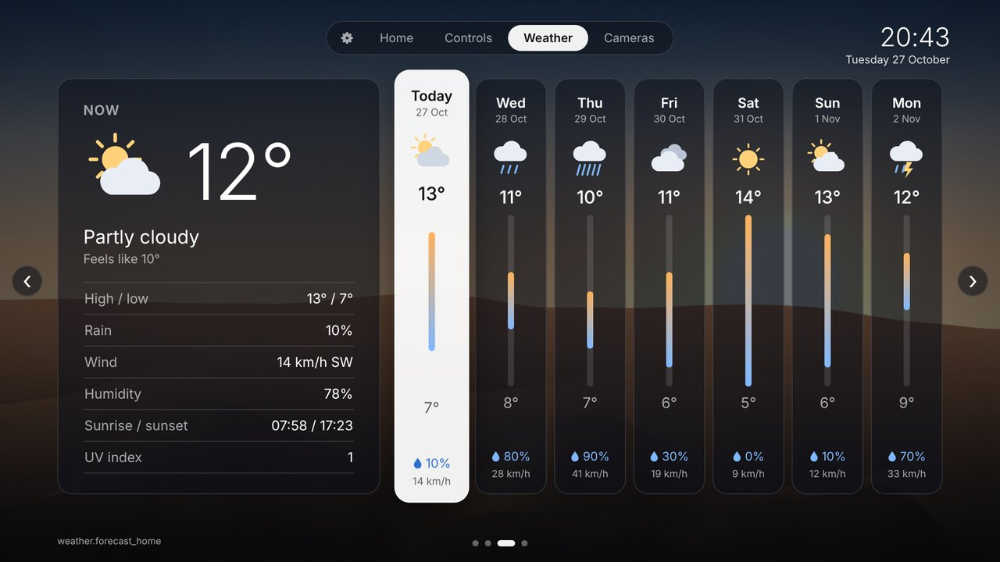 |

| Weather, style B: next 24 hours and week | Cameras |
|---|---|
| 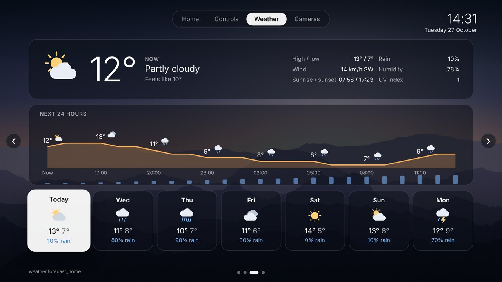 |  |

| Cameras, three in one layout | Light theme |
|---|---|
|  |  |

| Toolbar: Up from any page, the gear opens Settings | Home with 30 sensors and no apps |
|---|---|
| 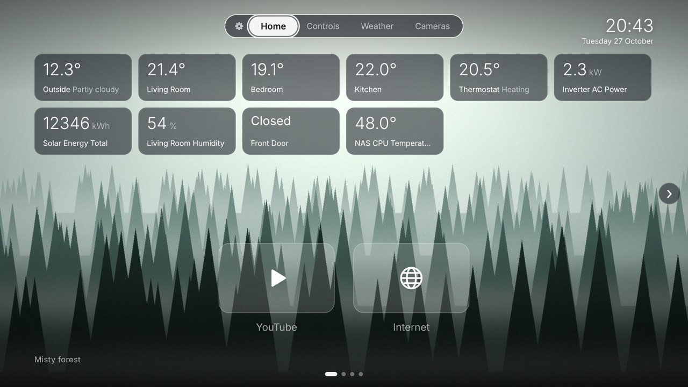 | 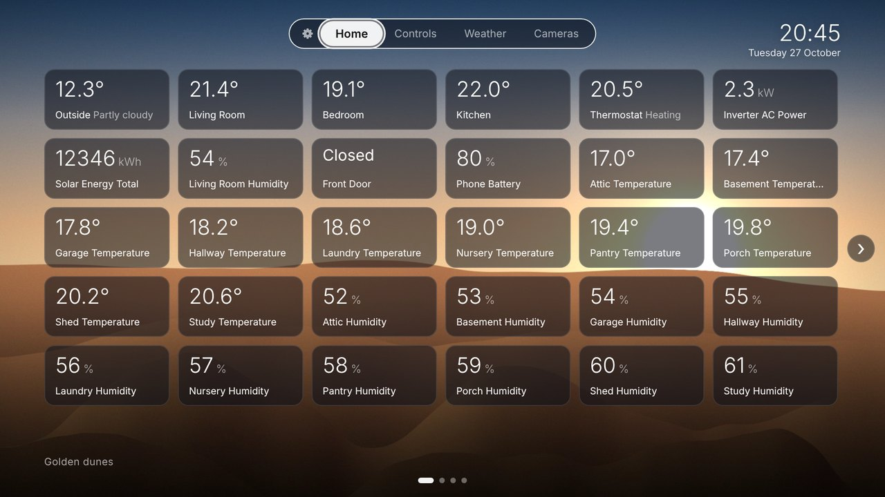 |

| Settings | Widget picker |
|---|---|
|  |  |

| Library (Jellyfin) | Movie details |
|---|---|
| 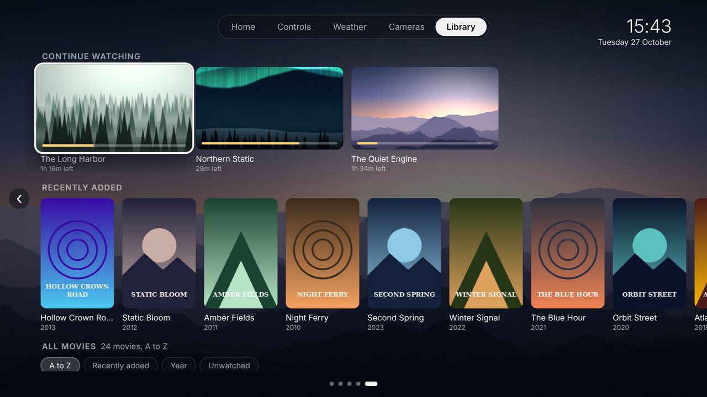 | 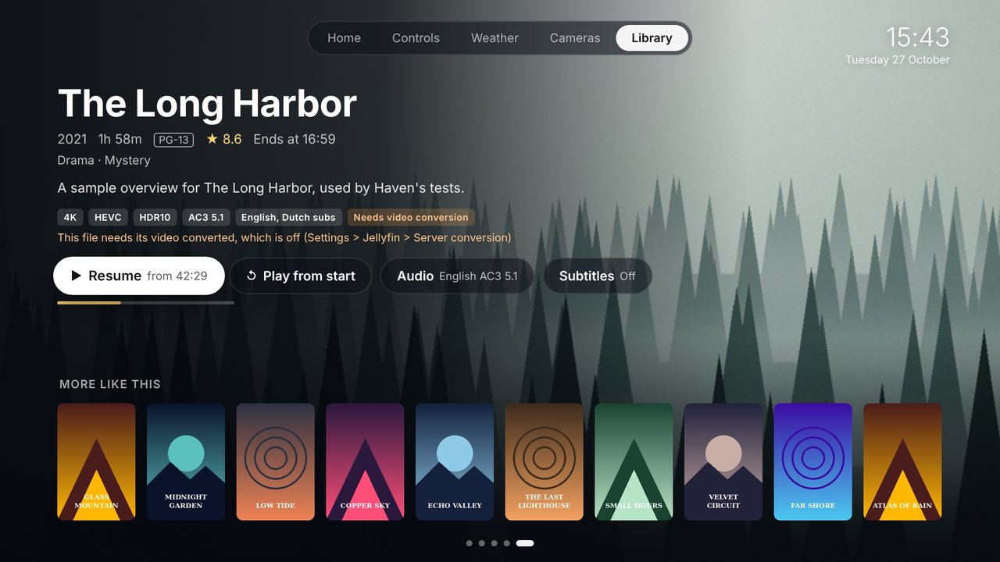 |

| Playing a film | Audio and subtitles |
|---|---|
| 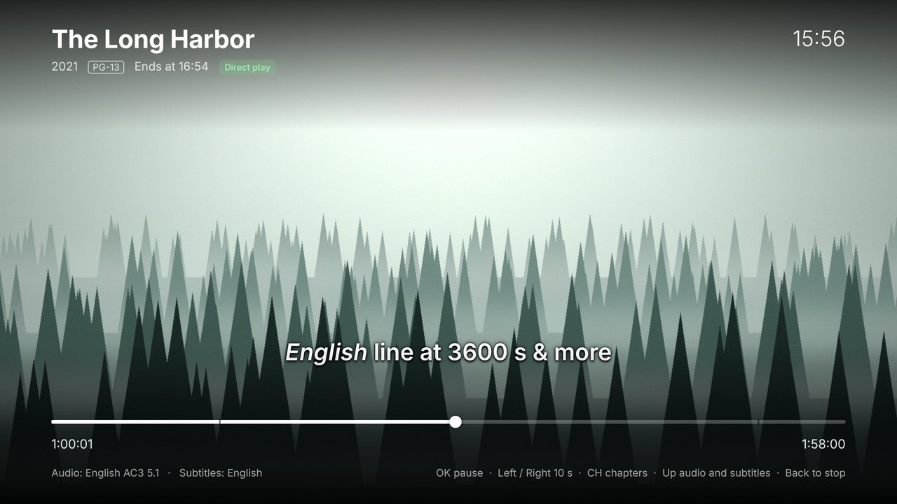 | 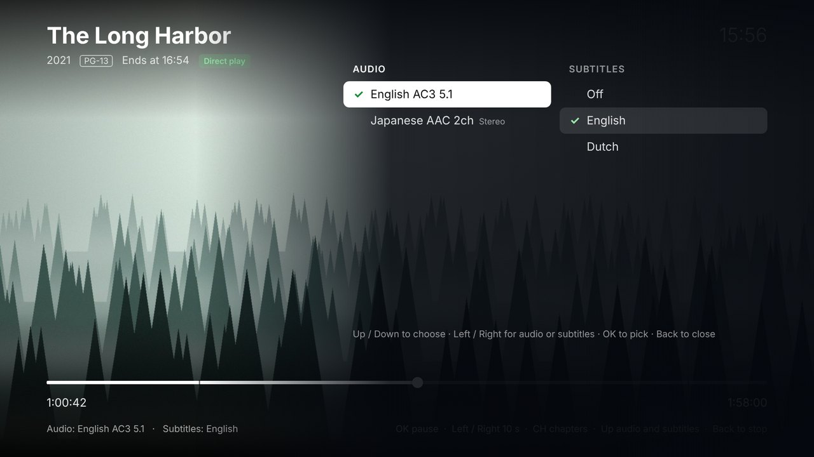 |

| Jellyfin: signed in, with what this TV can play | Settings > Screens: which pages, in what order |
|---|---|
| 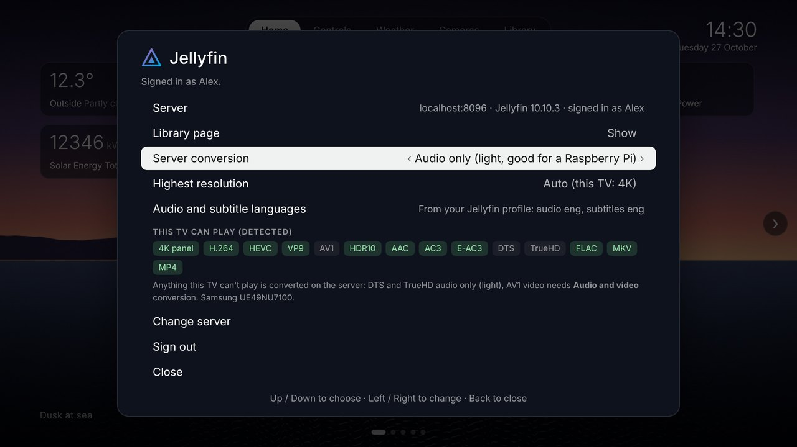 | 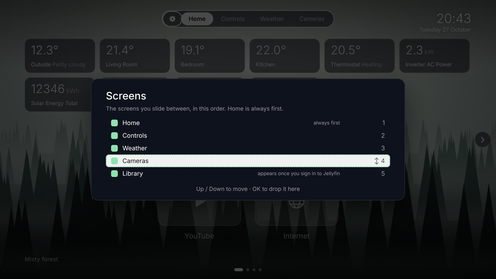 |

| Music | The small player on the other pages |
|---|---|
| 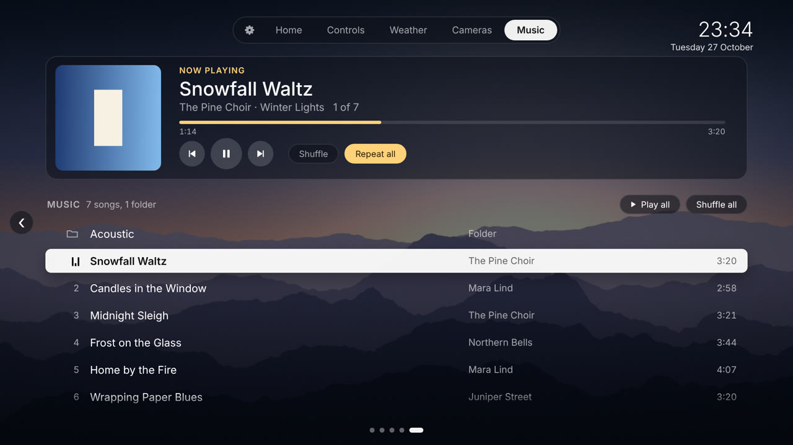 | 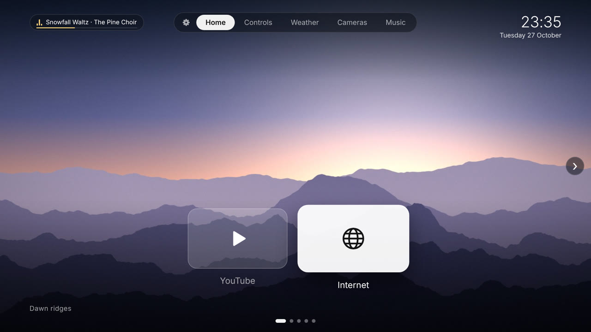 |

*Screenshots use sample data.*

## Why

Samsung's home screen on older Tizen TVs is slow and full of ads. Android TV owners can
debloat over ADB and replace the launcher, but Tizen allows neither. Haven is a normal
sideloaded Tizen web app instead: no root, no exploits, fully reversible. Add an optional
Home Assistant automation and it opens whenever the TV turns on, so in practice it becomes
the home screen.

## Features

- **Pages:** Home, Controls, Weather, Cameras, Library (once you sign in to Jellyfin) and
  Music (once you turn it on). Settings > **Screens** chooses which ones show and in what
  order, Home included. Haven opens on the first one, and Back leads there.
- **Toolbar:** the bar at the top holds the Settings gear and a tab for each page. Press
  **Up** from the top of any page to reach it, Left / Right to go to another page (it slides
  as you move), OK or Down to go into the page, OK on the gear for Settings. Dots at the
  bottom and a round arrow at each side also show where you are: Right on the last item (or
  Left on the first) reaches the arrow, then Right / Left again or OK slides to the next page.
- **Home:** clock, wallpaper, up to 30 live sensor cards (six to a row: weather, room
  temperatures, solar production, humidity, doors, thermostats) and the app dock. Without
  apps in the dock, the cards fill the screen (all 30 fit). With the dock, three rows show
  and the rest scroll: Up from the dock moves into the cards, a bar at the side shows where
  you are, and Up from the top row reaches the toolbar.
- **Controls:** a tile for each light, switch, scene, script and button, grouped by room (rooms A to Z, anything
  without a room last under *Other*), in the order you picked them within each room. OK
  switches it on or off, CH + / CH - dims it right on the tile. Up to 48; the page scrolls
  up and down if they don't all fit. With Settings > **Sensors location** on *Controls*, your
  sensors join their rooms here too, instead of on Home.
- **Weather:** your weather entity's forecast for the next seven days, with the current
  conditions, wind, humidity, sunrise and sunset. Two styles in Settings > **Weather style**:
  *Today and week* (a large card plus seven day columns) or *Next 24 hours and week* (an
  hourly temperature and rain chart above a week strip).
- **Cameras:** up to 9, laid out to fill the screen: 1 camera full size, 2 side by side, 3
  as one large and two small, then 2 by 2, 3 by 2 and 3 by 3. Stills refresh on their own,
  OK opens the live stream through Home Assistant's HLS.
- **Clock and wallpapers:** six built-in nature scenes plus your own photos from Home
  Assistant, resized for the TV automatically.
- **Library (Jellyfin):** sign in to your Jellyfin server from Settings with Quick Connect
  or a password and a fifth page appears with your movies: Continue watching, Recently
  added, and every movie in a poster grid you can sort and jump through by letter. OK opens
  the details: rating, runtime, when it would end, audio and subtitle languages, and whether
  this TV plays the file as it is. Haven detects what your TV can play and negotiates every
  title with Jellyfin accordingly, then plays it full screen with Samsung's own player:
  resume, seeking, chapters, audio tracks and subtitles, with your progress saved to
  Jellyfin. TV shows come next.
- **Auto-discovery:** on first connection Haven picks sensible defaults (weather, a few
  temperatures, solar, humidity, up to 12 lights and all cameras). It finds solar from the
  Energy dashboard, prefers camera sub-streams, and skips diagnostic entities. A picker on
  the TV lets you change everything, grouped by area.
- **Music:** an optional page that plays the songs in Home Assistant's media folder
  (`/media/Music`) on the TV: Play all, Shuffle, Repeat, folders, the cover and names from the
  MP3 tags, and Resume after the TV was off. It keeps playing while you move between pages, a
  small player at the top left shows the song, and the remote's media keys work everywhere.
- **Dark, light or auto theme:** auto follows `sun.sun`.
- **Seasonal and weather effects:** snow, rain, storms, fog, stars, autumn leaves, Halloween,
  Valentine's Day, St. Patrick's Day, spring blossoms, Fourth of July and New Year fireworks,
  and confetti on birthdays from your Home Assistant calendar. Light enough for a 2018 TV.
- **App dock:** YouTube and the Internet browser by default. Add any installed app from a
  checklist on the TV and put them in your own order; the dock scrolls when it's wider
  than the screen. You can also drop all apps from the dock.
- **Remote design updates with a safety net:** offline cache, automatic rollback of
  broken updates, and a safe mode.

## How it works

```
 Samsung TV (Tizen)                       Home Assistant
 ┌──────────────────────────┐             ┌─────────────────────────────────────┐
 │ Haven shell (installed)  │  HTTP       │ /config/www/haven/                  │
 │  - remote keys, app      │ ──────────► │   design/style.css, design.js       │
 │    launching, AVPlay     │             │   wallpapers/*.jpg + list.json      │
 │  - loads + caches design │             │                                     │
 │  - rollback, safe mode   │  WebSocket  │ API: states, areas, energy prefs,   │
 │ Haven design (from HA)   │ ◄─────────► │   subscribe_entities, call_service, │
 │  - widgets, cameras,     │             │   camera/stream (HLS)               │
 │    picker, theme         │             │                                     │
 └──────────────────────────┘             │ package: wallpaper sync script      │
                                          │ automation: open Haven on power-on  │
                                          └─────────────────────────────────────┘
```

- **The shell** (`app/`) is installed on the TV once. It handles the remote, launches apps,
  and loads the design.
- **The design** (`style.css` + `design.js`) lives in `/config/www/haven/design/`. Haven
  checks for changes at launch, when you return to it, and every 15 minutes. The last
  working version is cached on the TV.
- **Widgets** use one WebSocket to Home Assistant, subscribed only to the entities on
  screen, so the TV's CPU stays mostly idle.
- **Wallpapers** come from a small Python script on Home Assistant (Pillow ships with HA).
  It writes 1920x1080 copies of your picture folder plus a `list.json` for the TV.
- **Cameras:** the Cameras page shows recent stills from Home Assistant's camera proxy
  (only while that page is on screen). OK asks Home Assistant to convert the camera's RTSP
  feed to HLS; Haven plays it with the TV's video element, then falls back to Samsung's
  AVPlay, then to refreshing snapshots. One live stream at a time.

## Requirements

- **TV:** a Samsung Tizen TV that allows Developer Mode. Built and tested on a UE49NU7100
  (2018, Tizen 4.0). Other 2017 to 2021 models should behave similarly; newer ones are
  untested.
- **Home Assistant** with a fixed IP address on your network. Written against HA 2026.x.
- **A computer on the same network**, for installing: either
  [Apps2Samsung](https://github.com/Apps2Samsung/Apps2Samsung) (Windows, macOS or Linux), or
  Tizen Studio 6.1 (instructions below are for Windows). Both need a Samsung account for the
  signing certificate.
- **Optional:** file access to `/config` on Home Assistant (Samba share or Studio Code Server
  add-on), to edit the design there and use your own photos as wallpapers; and the Samsung
  Smart TV integration, to open Haven automatically at power-on.

## Repository layout

```
app/                            the Tizen app (installed on the TV)
  config.xml                    app ID HavenHome1.Haven, privileges, network access
  index.html                    shell page
  shell-config.example.js       copy to shell-config.js and add your HA address + token
  shell/boot.js                 loader, cache, rollback, safe mode, app launching
  design/                       built-in copy of the design (first run and fallback)
  img/                          built-in wallpapers + walls.js
ha/                             files for Home Assistant's /config
  www/haven/design/             the live design the TV loads
  www/haven/wallpapers/         filled by the sync script
  haven/haven_wallpapers.py     resizes your pictures and writes list.json
  packages/haven.yaml           shell_command, sync automation, sync script
  examples/haven_open_on_power_on.yaml
tools/
  serve.py                      fake Home Assistant for testing in a desktop browser
  publish_design.py             copies app/design to Home Assistant
  make_wallpapers.py            regenerates the built-in wallpapers and icon
docs/screenshots/
```

## Setup

There are two ways to get Haven on the TV:

- **Apps2Samsung** (easiest): Haven is in its community catalog. You enter your Home Assistant
  address and token, and it installs Haven for you. No Tizen Studio, no certificate of your
  own, no files to edit.
- **Tizen Studio:** build and install it yourself, for when you want to change the installed
  part of Haven or test your own builds.

Both start with step 1. The Home Assistant files (step 3) and opening Haven at power-on
(step 4) are optional with either.

### 1. A token for the TV

1. Give Home Assistant a fixed IP address (a DHCP reservation on your router). The TV may
   not resolve `homeassistant.local`.
2. Optional, but a good idea: a separate non-admin Home Assistant user for the TV (see
   [Security notes](#security-notes)), and sign in as that user for the next step.
3. Create a long-lived access token: your HA profile > **Security** > **Long-lived access
   tokens** > **Create token**. Copy it, because it's shown only once.

### 2. Install on the TV

#### Option A: Apps2Samsung

Haven is listed in the Apps2Samsung
[community catalog](https://github.com/Apps2Samsung/tizen-community-packages), which builds it
from this repository. Apps2Samsung signs it with a certificate it creates for your TV.

1. **Developer Mode:** on the TV, open **Apps**, then type **1 2 3 4 5**. On the Samsung
   Smart Remote, press the **123** button for an on-screen number pad. Switch Developer
   Mode **On**, enter the IP of the computer that will run Apps2Samsung, then fully restart
   the TV: hold the power button until it reboots, or unplug it for 30 seconds.
2. **Apps2Samsung:** download it from its
   [releases page](https://github.com/Apps2Samsung/Apps2Samsung/releases) and start it. It
   finds the TV on your network. The first install for a TV asks you to sign in to a Samsung
   account once, to create that TV's certificate.
3. **Haven:** pick it from the community apps (category *Other*). Apps2Samsung asks for:
   - your **Home Assistant address**, such as `http://192.168.1.10:8123`: no path and no
     slash at the end, Haven adds the rest;
   - the **token** from step 1.

   It writes both into Haven, then installs and opens it.
4. **First-run check:** press **Yellow** on the remote. The status panel should show
   *Home Assistant widgets: connected*, and YouTube and Internet highlighted green in the
   app list.

**Updating:** a push to this repository reaches the catalog within a day. Update Haven from
Apps2Samsung: it reuses your TV's certificate and fills in the address and token again, so
Haven keeps its settings on the TV. You can change the address on the TV (Settings > Home
Assistant address); a new token means installing again from Apps2Samsung with the new value.

#### Option B: build it yourself with Tizen Studio

**Configure the app**

1. Copy `app/shell-config.example.js` to `app/shell-config.js` and fill in:
   - `base`: `http://<HA-IP>:8123/local/haven/`. Give HA a fixed IP (DHCP reservation);
     the TV may not resolve `homeassistant.local`.
   - `haToken`: the token from step 1.

**Prepare the TV**

2. **Developer Mode:** on the TV, open **Apps**, then type **1 2 3 4 5**. On the Samsung
   Smart Remote, press the **123** button for an on-screen number pad. Switch Developer
   Mode **On**, enter your computer's IP, then fully restart the TV: hold the power button
   until it reboots, or unplug it for 30 seconds.

**Prepare the computer**

3. **Tizen Studio:** download the **web-ide** installer for your OS from the
   [Tizen Studio download page](https://developer.tizen.org/development/tizen-studio/download).
   On Windows, install it to a path without spaces, such as `C:\tizen-studio`.
4. **Package Manager:** open `C:\tizen-studio\package-manager\package-manager.exe` and
   install:
   - **Extension SDK** tab: **TV Extensions Tools** and **Samsung Certificate Extension**.
   - **Main SDK** tab, under Tizen SDK tools: **Certificate Manager**. The web-ide install
     may leave it out, which shows up as *Certificate Manager is not installed or the
     installation path is invalid*.

**Connect, certify, install**

5. **Connect to the TV** from PowerShell. Adding the tools to the path also avoids
   PowerShell's *"sdb is not recognized"*.
   ```powershell
   $env:Path += ";C:\tizen-studio\tools;C:\tizen-studio\tools\ide\bin"
   sdb connect <TV-IP>
   sdb devices          # should list your TV model
   ```
6. **Samsung certificate:** in Tizen Studio, go to **Tools > Certificate Manager**. Click
   **+**, choose **Samsung** (not Tizen), then **TV**, and name the profile `haven`.
   - Create an author certificate (pick a password) and sign in with your Samsung account.
   - For the distributor certificate, choose privilege **Public**. The TV's ID is added
     automatically while it's connected.
7. **Permit to install:** in **Tools > Device Manager**, right-click your TV and choose
   **Permit to install applications**. Without this, the install fails with error
   **118012**.
8. **Package, install and run:**
   ```powershell
   cd <path-to>\haven-tv
   tizen package -t wgt -s haven -- app
   tizen install -n Haven.wgt -s <TV-IP>:26101 -- app
   tizen run -p HavenHome1.Haven -s <TV-IP>:26101
   ```
   Delete `app\Haven.wgt` before packaging again, so it doesn't end up inside the new one.
9. **First-run check:** press **Yellow** on the remote. The status panel should show:
   - *Design: Home Assistant*
   - *Home Assistant widgets: connected*
   - a wallpaper count
   - YouTube and Internet highlighted green in the app list

Back up `app/shell-config.js` and your certificate folder
(`C:\Users\<you>\SamsungCertificate\haven`). Updating Haven in place later requires the
same certificate; with a new one you'd have to uninstall it first and lose its settings.

**Switching between Option A and B:** the two are signed with different certificates, and
the TV won't replace an app signed by another one. Uninstall Haven from the TV first (from
the TV's Apps screen), which also deletes its settings on the TV: the widgets you picked,
the dock, the Jellyfin sign-in.

### 3. Optional: Home Assistant files

Without these, Haven runs the design and wallpapers built into the app, and the widgets,
cameras, Library and Music all work. Copy them to Home Assistant to edit the design there
(see [Changing the design](#changing-the-design)) and to show your own photos as wallpapers.

1. Copy the files from `ha/` into `/config`:
   - `ha/www/haven/` to `/config/www/haven/`
   - `ha/haven/haven_wallpapers.py` to `/config/haven/haven_wallpapers.py`
   - `ha/packages/haven.yaml` to `/config/packages/haven.yaml`
2. In `haven.yaml`, change `/media/Pictures` to your picture folder. It is only read; the TV
   gets resized copies without location data.
3. Make sure `configuration.yaml` loads packages. `packages:` must sit **under**
   `homeassistant:`; on its own at the top level you get *Integration 'packages' not
   found*.
   ```yaml
   homeassistant:
     packages: !include_dir_named packages
   ```
4. Check the configuration, then restart Home Assistant. Since HA 2026.2, Developer Tools
   is under **Settings** (bottom of the page), not in the sidebar. The restart is also
   needed the first time `/config/www` exists.
5. Run the wallpaper sync once: **Settings > Developer Tools > Actions**,
   `shell_command.haven_wallpapers`, **Perform action**. The response shows something like
   `haven_wallpapers: 42 wallpapers, 42 new`. After that it runs at startup and every 15
   minutes. Each run stops after 50 seconds, so a big first import takes a few runs.
6. Check in a browser: `http://<HA-IP>:8123/local/haven/wallpapers/list.json` should list
   your pictures.

### 4. Optional: open Haven when the TV turns on

Without this step, Haven is an app like any other: open it from the TV's Apps screen. With
**Autorun Last App** on (Settings > General > Smart Features), the TV also reopens it when it
was the last app you used.

To have it open every time the TV turns on, so it takes the place of Samsung's home screen:
Tizen won't let a sideloaded app replace Smart Hub, but Home Assistant's Samsung Smart TV
integration can launch it.

1. Test it first in **Developer Tools > Actions**:
   ```yaml
   action: media_player.play_media
   target:
     entity_id: media_player.samsung_tv
   data:
     media:
       media_content_type: app
       media_content_id: HavenHome1.Haven
   ```
2. If Haven opens, add the automation from
   [`ha/examples/haven_open_on_power_on.yaml`](ha/examples/haven_open_on_power_on.yaml).
   It triggers on the **media_player** entity (not the remote one) turning on, waits 10
   seconds, and opens Haven.
3. Check under **History** that HA really sees your TV go off and on. Some TVs stay "on"
   in standby.
4. If the TV asks to allow Home Assistant after every power cycle, go to TV **Settings >
   General > External Device Manager > Device Connection Manager**. Set **Access
   Notification** to **First Time Only**, and set Home Assistant to **Allow** in the
   **Device List**.
5. Turn **Autorun Last App** off (Settings > General > Smart Features). With both on, the
   TV reopens Haven itself, the automation's launch arrives while it's already open, and
   the TV shows *Not available*.

Developer Mode can stay on or be turned off; Haven keeps running either way. You only need
it again to reinstall the app.

## Using it

| Key | Does |
|---|---|
| Arrows | Move between items on the page (the dock and sensors on Home, tiles on Controls and Cameras; sensor tiles too when they're on Controls) |
| Up from the top of a page | The toolbar: Left / Right for another page, OK on the gear for Settings, Down to go back into the page |
| Right on the last item / Left on the first | Focus the round arrow at the side of the screen |
| Right / Left again, or OK, on the arrow | Slide to the next page (the opposite arrow key goes back to where you were) |
| OK | Open an app on Home; switch a light or switch, or run a scene, script or button, on Controls; open a camera on Cameras |
| Left / Right on Weather | Move along the days; the large card shows the focused day |
| CH + / CH - on a dimmable light (Controls) | Brightness up / down in 10 % steps, shown on the tile (down to 1 %, then off) |
| Left / Right in a camera | Switch to the previous / next camera |
| Back | Close a panel or camera; in a Music subfolder, go up; on any other page, go back to the first screen (Home, unless you changed it) |
| Play / Pause, Stop, Fast-forward, Rewind | Music on any page: pause or play, stop, next song, previous song |
| Yellow | Installed apps and status (design source, HA connection, camera player) |
| Red, within 6 s of opening | Safe mode: the built-in design |

On a remote without CH keys, Page Up / Page Down do the same (handy in a browser preview).

**Choosing apps:** Settings (the gear in the toolbar) > **Apps in the dock**:
- *In the dock* lists your apps in dock order; *Other apps* lists everything else installed
  on the TV, by name. Haven itself and hidden system apps aren't offered.
- **OK** adds or removes an app. The focus stays where you are, so you can tick several in
  a row.
- To have no apps at all, untick them all: the sensors take the whole screen, and the focus
  starts on the toolbar.
- To reorder, press **Right** on an app in the dock to pick it up, **Up / Down** to move
  it, and **OK** to drop it.
- Apps show their own icon; apps without one show their initials. YouTube and Internet
  keep their simple symbols unless Settings > Tile icons is set to App icons.

**Controls page:**
- Tiles are grouped by room: rooms A to Z, anything without a room last under *Other*.
  Within a room they keep the order you ticked them in the picker.
- A lit tile turns bright; dimmable lights show the level ("On · 60%") and a thin bar.
- **Scenes, scripts and buttons** (`scene`, `script`, `button` and `input_button` entities) run
  when you press OK; they're never switched off. The tile says when they last ran
  ("Activated 20:15" today, "Activated 27 Oct" before, "Not used yet"), a script shows
  *Running* while it runs, and the tile pulses when you press it. Pressing again before Home
  Assistant has answered does nothing, so a double press runs it once.
- **CH + / CH -** change the focused light's brightness on the tile itself, no pop-up.
  Holding a key sends one update to Home Assistant when you let go, not one per step. The
  first time you focus a dimmable light, Haven shows a short tip.
- Lights that only switch on and off say so if you try to dim them.
- More than fit on the screen? The page scrolls up and down as you move, with soft edges
  and small arrows showing there's more.

**Choosing screens:** Settings > **Screens** lists all six screens in their order. **OK** shows
or hides one; **Right** picks it up, **Up / Down** move it, **OK** drops it. The toolbar, the dots
and sliding follow at once.
- The first screen that's shown is where Haven opens and where **Back** takes you; the list
  marks it. Home is first unless you move it.
- Home can be hidden like the others, for a Haven that's only cameras or only music, say. Its
  app dock goes with it: YouTube and the browser then open from the TV's own Home button.
- At least one screen stays on. Library only appears while you're signed in to Jellyfin, so if
  it's the only one ticked and you sign out, Home comes back.
- Music starts hidden; tick it here to use it.

**Choosing widgets:** Settings > **Home Assistant widgets**. It lists a
*Suggested* section, then everything else grouped by area, with live values. OK ticks or
unticks; items appear in the order you tick them. Each kind goes to its own page: sensors
to Home (up to 30), lights and switches to Controls (up to 48), cameras to Cameras (up to
9). Scenes, scripts and buttons go to Controls with the lights. Names are shortened by room,
so "Living Room Temperature" shows as "Living Room".
Rename the entity in HA for a different label.

**Sensors location:** Settings > **Sensors location** puts the sensors on *Home* (the default)
or on *Controls*. On Controls each sensor joins its room, after that room's lights and
switches, and sensors without a room go under *Other*. The room is the heading there, so a
sensor shows the rest of its name: "Living Room Temperature" becomes "Temperature" under
*Living Room*. OK and CH + / CH - do nothing on a sensor tile. Handy when Home is hidden in
Settings > Screens; if the screen you pick is hidden, the setting says so.

**Weather page:**
- Uses the weather entity on your Home page, or the first one Haven finds (Met.no, which
  Home Assistant sets up by default, works well). Units follow Home Assistant.
- The forecast comes from Home Assistant's `weather/subscribe_forecast`, the same source
  as its own forecast cards, and updates by itself.
- *Today and week* (style A) works with every weather integration. *Next 24 hours and week*
  (style B) also needs an hourly forecast; if your integration has none, the chart says so
  and the rest of the page still shows.
- Left / Right move along the days and the large card follows: today shows the current
  conditions, other days their forecast with rain amount, wind and humidity.
- Seasonal effects keep running behind the forecast. The Yellow panel shows which weather
  entity the page uses.

**Cameras:**
- The grid adapts to how many you pick: 1 fills the screen, 2 sit side by side, 3 show as
  one large and two small, then 2 by 2, 3 by 2 and 3 by 3. No scrolling.
- Stills refresh every 4 seconds with up to 4 cameras. With more, the focused one refreshes
  every 3 seconds and the others every 12, to keep Home Assistant and the TV relaxed. A
  small badge shows how old each picture is. Nothing is fetched while you're on another
  page.
- OK opens the live stream; Left / Right in the player switch cameras, Back returns to the
  grid.
- Prefer the light sub-stream entity (Reolink *Fluent*, Tapo *SD* or *live view*): it
  starts quicker, and every older Samsung decodes it. Use an H.264 stream rather than
  H.265.
- Expect the picture a few seconds behind live, and 2 to 5 seconds to start.
- Home Assistant's HLS only passes AAC audio, so some cameras (the Tapo C200, for one) have
  no sound this way.
- The Yellow panel shows which player worked on your TV and the last problem, if any.

**Seasonal effects:** Settings > **Seasonal effects**.

| When | Effect |
|---|---|
| Your HA weather says snow / sleet or hail | Snow / light snow with rain |
| Rain / pouring / thunderstorm | Rain / heavy rain / rain with lightning flashes |
| Fog | Slow drifting fog |
| Clear night (and nothing else is on) | Twinkling stars and the odd shooting star |
| Sun setting (and not overcast) | A warm golden-hour glow from the bottom |
| 22 Sep to 30 Nov | Autumn leaves (more on Thanksgiving) |
| 24 to 31 Oct | Halloween: bats and rising embers |
| 1 Dec to 6 Jan | Christmas snow |
| 31 Dec 23:50 to 1 Jan 00:30 | Fireworks, with a countdown in the last minute of the year |
| 14 Feb / 17 Mar | Valentine's hearts / St. Patrick's clovers |
| 20 Mar to 15 May | Spring blossoms |
| 4 Jul from 20:00 | Fourth of July fireworks |
| A calendar event with "birthday" in its title | Confetti all day, and the event's name as a tip |

- **What wins:** fireworks, then birthdays, then real weather, then holidays, then seasons,
  then clear-night stars. So real rain beats Christmas snow, and real snow beats Halloween.
- **Wind** from your weather entity blows rain, snow and leaves sideways, in the direction
  it's actually blowing.
- **Modes:** *Holidays, seasons and weather* (default), *Holidays and seasons*, *Weather
  only*, or *Off*.
- **Testing:** *All + frame rate* adds a small counter at the bottom left (frames per second
  now, and the lowest second of the last 10); no other option shows it. The *Preview*
  options show any one effect right now; the New Year preview also runs a 10-second countdown.
- **How it stays light:** every particle (70 for snow, around 100 for heavy rain or
  fireworks) is drawn once and moved only by the TV's compositor with CSS transforms. No
  canvas, no blur. Fog is the heaviest, so check it with the counter if your TV is older.
  Effects sit behind the cards (fireworks go in front for their short show) and pause on
  the Cameras page, in the camera player, while a film plays and while Haven is in the background. The Yellow
  panel shows what's running and why.

**Jellyfin:** Settings > **Jellyfin**. Needs Jellyfin 10.9 or newer.
- **Connecting:** Haven first tries your Home Assistant's address on port 8096, which is
  where the Jellyfin add-on listens. If your server is elsewhere, type its address once: an IP
  (`192.168.1.20` becomes `http://192.168.1.20:8096`), or a full URL such as
  `https://media.example.com/jellyfin`.
- **Signing in:** *Quick Connect* shows a 6-digit code; enter it in Jellyfin on your phone
  (your profile > Quick Connect) and the TV signs in by itself. Quick Connect has to be
  turned on in Jellyfin's dashboard; otherwise sign in with your username and password.
  Haven keeps the session on the TV, never in `/config/www`, and *Sign out* ends it on the
  server too.
- **What this TV can play** is detected at startup (4K panel, HEVC, VP9, AV1, HDR, Dolby,
  DTS, ...) and sent to Jellyfin with every title, so each TV model gets the right answer:
  play the file as it is, or convert only what's needed.
- **Server conversion:** what your server may convert when the TV can't play a file:
  - *Audio only* (default): video is always passed through untouched; only unsupported
    audio (DTS, TrueHD) is converted. Light enough for a Raspberry Pi.
  - *Audio and video*: also converts video (AV1 on older TVs, picture subtitles, anything
    above the highest resolution). Needs a strong server or a GPU.
  - *Off*: only files the TV plays as they are.
  Titles that would need more than you allow say so before playing, instead of failing
  mid-film.
- **Highest resolution:** *Auto* uses the panel (4K or 1080p); 1080p or 720p save bandwidth.
- **Languages:** audio and subtitle preferences come from each user's Jellyfin profile.
- **Library page:** shown while you're signed in. To hide it or move it without signing out,
  use Settings > Screens.
- The Yellow panel shows the Jellyfin server, user and conversion setting.

**Library:** the fifth page, after Cameras.
- **Rows:** *Continue watching* (with how much is left), *Recently added*, then *All movies*.
  Up and Down move between rows, Left and Right along them.
- **All movies:** a poster grid with sort chips above it: A to Z, Recently added, Year and
  Unwatched. Watched titles carry a tick. Posters load as you scroll, so large libraries stay
  quick.
- **Jumping:** CH + / CH - jump to the next or previous letter in A to Z (a letter rail on the
  right shows where you are), or three rows at a time in the other sorts.
- **Details:** OK on a poster. Year, runtime, age rating, star rating, when it would end,
  genres, the plot, the file's resolution, codecs and languages, and a badge saying how it
  will play: *Direct play*, *Audio converted* or a warning when it needs more conversion than
  you allow (with the setting to change). Audio and Subtitles show what Jellyfin will pick
  from your profile; OK on either opens a list to choose another, and the badge updates (a
  DTS track turns *Direct play* into *Audio converted*). *More like this* sits underneath.
  Back closes it.

**Playing:** *Resume*, *Play* or *Play from start* in the details view.
- **The player:** Samsung's AVPlay, the TV's own video engine, so MKV, HEVC, HDR10 and Dolby
  audio play as they are. When Jellyfin converts something (only the audio, by default), it
  sends an HLS stream instead. The bar at the top says which: *Direct play*, *Audio
  converted* or *Video converted*.
- **Remote:** OK or Play / Pause pauses. Left / Right jump 10 seconds; hold them and the
  steps grow to 30 and 60 seconds, and the jump happens when you let go. Fast-forward and
  rewind jump 30 seconds. CH + / CH - go to the next or previous chapter (5 minutes when the
  file has none). Up opens audio and subtitles. Back or Stop ends playback.
- **Audio tracks:** switched by the TV on the spot when the file plays directly; otherwise
  Jellyfin prepares a new stream from the same moment.
- **Subtitles:** text subtitles (SRT, ASS, WebVTT, embedded or separate files) are drawn by
  Haven, with italics kept. Picture subtitles (PGS, DVD) can only be burned into the video,
  so they need *Audio and video* conversion; with *Audio only* Haven says so and keeps playing.
- **Progress:** Jellyfin hears where you are every 10 seconds and on pause, seek and stop, so
  *Continue watching* is current here and in every other Jellyfin app. Watch to the end and
  the title is marked watched. Leaving Haven (Home button, another source) stops playback and
  saves the spot; if the TV is simply switched off, the last report (at most 10 s old) counts.
- **If a file won't play directly** (a TV can misreport what it decodes), Haven asks Jellyfin
  to repackage it once and says so. Conversions are ended on the server as soon as you stop,
  so a Raspberry Pi isn't left working.
- The screensaver stays off while a film plays, and a design update from Home Assistant
  waits until it ends. The Yellow panel shows how the last title played.

**Music:** turn it on in Settings > **Screens**. Nothing needs installing on Home Assistant.
- **Where the songs come from:** Home Assistant's media folder, the same one its Media panel
  shows (*My media*: `/media` on Home Assistant OS, the `media` folder on the Samba share).
  Haven opens a folder named `Music` in it if there is one, otherwise all of My media. To use
  another top folder, change Settings > **Music folder**. Subfolders show at the top of the
  list; OK opens one, Back goes up.
- **Playing:** OK on a song plays the folder from that song. **Play all** plays it in order,
  **Shuffle all** shuffled. The card at the top has previous, play / pause and next, plus
  **Shuffle** and **Repeat** (all, one, off). CH + / CH - move a page at a time through a long
  list.
- **Names and covers:** until a song has played, the list shows its filename, tidied:
  `03 - Artist - Title.mp3` becomes *Title* by *Artist*, and a leading track number goes. For
  the song that's playing (and the next one), Haven reads the MP3 tags: title, artist, album
  and the cover. Those names and the song's length are then kept for the list. A song
  without its own cover shows `cover.jpg` or `folder.jpg` from its folder, if there is one.
- **On every page:** the music carries on while you move around. A small player at the top
  left shows the song; **Play / Pause**, **Stop**, **Fast-forward** (next song) and **Rewind**
  (previous, or back to the start of this one) work on any page. A camera or a film pauses
  the music and it carries on when you close them.
- **Leaving Haven** (YouTube, another source, the TV off) pauses the music; the TV can't play
  it in the background. Back in Haven it waits, paused, for Play. After the TV was off, the
  Music page offers **Resume**, and Play on the remote does the same. It never starts by itself.
- **Formats:** MP3 everywhere. The Yellow panel lists what your TV's player reports for AAC,
  FLAC, OGG and WAV; a file it can't play is greyed out in the list and skipped.
- **How it works:** Home Assistant lists the folder over the widgets' connection and hands
  the TV a signed link per file, valid for 24 hours, so the token never goes into a link.
  Tags are read from the start of the file only (a Range request), never the whole folder.
  While music plays, a design update from Home Assistant waits until it stops.

**Other settings:** wallpaper interval, wallpaper source (built-in, Home Assistant or both),
slow motion (off by default, it costs GPU), weather style, theme, 12 or 24-hour clock, app icons,
wallpaper names, and the Home Assistant address.

## Changing the design

Edit `/config/www/haven/design/style.css` or `design.js` on Home Assistant:

- **At home:** open the Samba share in your editor, or copy this repo's design over with
  `python tools/publish_design.py \\homeassistant\config\www\haven`.
- **Anywhere:** use the Studio Code Server add-on inside the HA web UI.

How the TV handles it:

| Situation | What the TV shows |
|---|---|
| You saved a change | Haven downloads it and reloads after 20 s without remote presses, or when you return to it (never during a film) |
| The change has an error | The previous working design, plus a message with the error. That version is skipped until you edit again. |
| Home Assistant is offline | The last working design, instantly. Built-in wallpapers instead of your photos. |
| First launch with HA offline | The built-in design |
| It looks wrong | Press Red within 6 seconds of opening Haven |

Rules for `design.js`:
- Plain ES5, since the 2018 web engine is an old Chromium: no arrow functions,
  `let`/`const`, classes or `?.`.
- Use `window.Haven` for anything TV-specific.
- Call `Haven.ready()` once the screen is drawn. If it doesn't, the shell rolls the change
  back.

Needs a reinstall: anything in `config.xml`, `shell-config.js` (address default, token),
`index.html` and `shell/boot.js`. Copy your favourite design back into `app/design/` before
reinstalling, so it becomes the new fallback.

## Troubleshooting

| Symptom | Fix |
|---|---|
| *Integration 'packages' not found* | `packages:` must be under `homeassistant:` in `configuration.yaml` |
| No Developer Tools in the sidebar | HA 2026.2+: Settings, bottom of the page, or Ctrl+K |
| Developer Mode menu doesn't exist | It's hidden: Apps screen, then type 1 2 3 4 5 |
| *sdb is not recognized* in PowerShell | Use `.\sdb`, or add `C:\tizen-studio\tools` to `$env:Path` |
| *Certificate Manager is not installed or the installation path is invalid* | Package Manager > Main SDK > Tizen SDK tools > Certificate Manager > install |
| Only "Tizen" in the certificate wizard, no "Samsung" | Install Samsung Certificate Extension, restart Tizen Studio |
| Install fails with *install failed[118012]* | Device Manager > right-click TV > Permit to install applications |
| TV boots to Samsung's home, not Haven | Expected; add the optional power-on automation (setup step 4) |
| TV asks to allow Home Assistant every time | Device Connection Manager > Access Notification > First Time Only |
| *Not available* when the automation runs | Turn off Autorun Last App |
| Automation never fires | Trigger on the media_player entity; check History shows off then on |
| "Home Assistant token rejected" at the top | Wrong token: in Apps2Samsung, install Haven again with the right one; with Tizen Studio, fix `haToken` in `shell-config.js` and reinstall |
| Apps2Samsung: no widgets, "Home Assistant offline" | Check the address you entered (`http://<HA-IP>:8123`, the IP rather than `homeassistant.local`) and install again |
| Apps2Samsung: installing Haven fails | Haven was installed with Tizen Studio before: uninstall it from the TV first (this deletes its settings), see setup step 2 |
| Jellyfin: "No Jellyfin server answered" | Check the address and port (8096); the TV and the server must be on the same network |
| Jellyfin: Quick Connect "turned off on this server" | Jellyfin Dashboard > Quick Connect > enable, or sign in with a password |
| No Library page | Sign in under Settings > Jellyfin, and check Library is ticked in Settings > Screens |
| No Music page | Tick Music in Settings > Screens |
| Music: "No songs in Music yet" | Copy the songs into `/media/Music` (the `media` folder on the Samba share), or pick the folder in Settings > Music folder |
| Music: a song is greyed out or skipped | The TV can't play that format (Yellow panel lists what it can), or the file was moved |
| Library: a title says it needs video conversion | The TV can't play that video format; allow *Audio and video* in Settings > Jellyfin, or use a server with a GPU |
| Player: "Direct play didn't work on this TV" | The file is repackaged by Jellyfin instead; nothing to do. The Yellow panel shows the reason |
| Player: long wait at the start of a converted title | The server is converting; on a Pi keep *Server conversion* on *Audio only* |
| Player: picture subtitles say they need video conversion | They're images (PGS, DVD) and must be burned in; pick a text track, or allow *Audio and video* |
| A camera shows only snapshots | Yellow panel shows why; use the camera's H.264 sub-stream |

## Security notes

- The token can do anything its HA user can do, and it is packaged into the app on the TV.
  - With Apps2Samsung, it's written into the package on your computer, and Apps2Samsung
    keeps it there to fill it in again on updates.
  - With Tizen Studio, it's in `shell-config.js`: keep the file out of git (it's in
    `.gitignore`), never copy it into `/config/www`, and never share a `.wgt` you built
    with it.
- Consider a separate non-admin HA user for the TV. It can still read and switch
  everything, but it can't change HA's configuration.
- If the TV is lost or sold, delete the token in HA, and sign the TV out in Jellyfin
  (Dashboard > Devices) if you used the Library.
- Everything in `/config/www` can be fetched without logging in by anyone who can reach
  your HA, including from the internet if HA is exposed. Only the resized wallpapers and
  the design are there, never the token.

## Try it on a computer

```
python tools/serve.py        # fake Home Assistant at http://localhost:8123/local/haven/
```

Copy `app/shell-config.example.js` to `app/shell-config.js`, then open
`app/index.html?base=http://localhost:8123/local/haven/` in Chrome. Keyboard controls:
- **Arrow keys** move, **Enter** opens, **Esc** closes.
- **Page Up / Page Down** stand in for CH + / CH - (dimming on Controls).
- **`Y`** toggles the status panel, **`r`** within 6 seconds is safe mode.

Edit `ha/www/haven/design/*` and watch it update. Add `&ha=http://<HA-IP>:8123&token=<token>`
to try the widgets against a real Home Assistant. That may need `cors_allowed_origins`
under `http:` in HA; the TV app itself isn't limited by this.

## Undo

Uninstall Haven from Apps on the TV and turn Developer Mode off. On Home Assistant, delete
`/config/www/haven`, `/config/haven`, `/config/packages/haven.yaml` and the power-on
automation, then revoke the token.

## Credits

Built by [natureglass](https://github.com/natureglass) together with Claude (Anthropic).