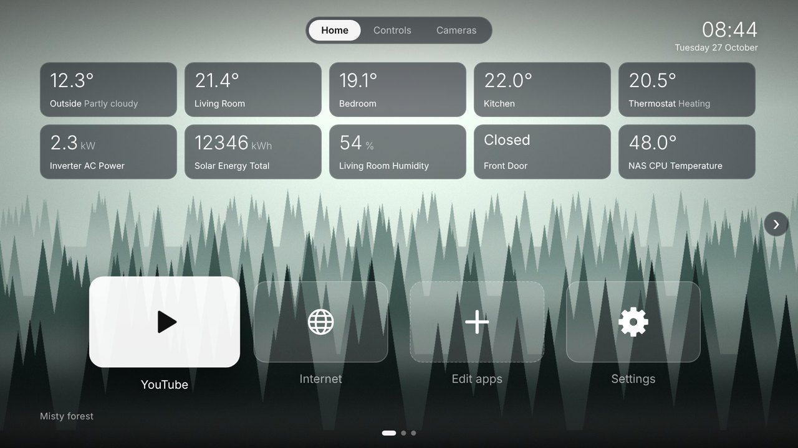
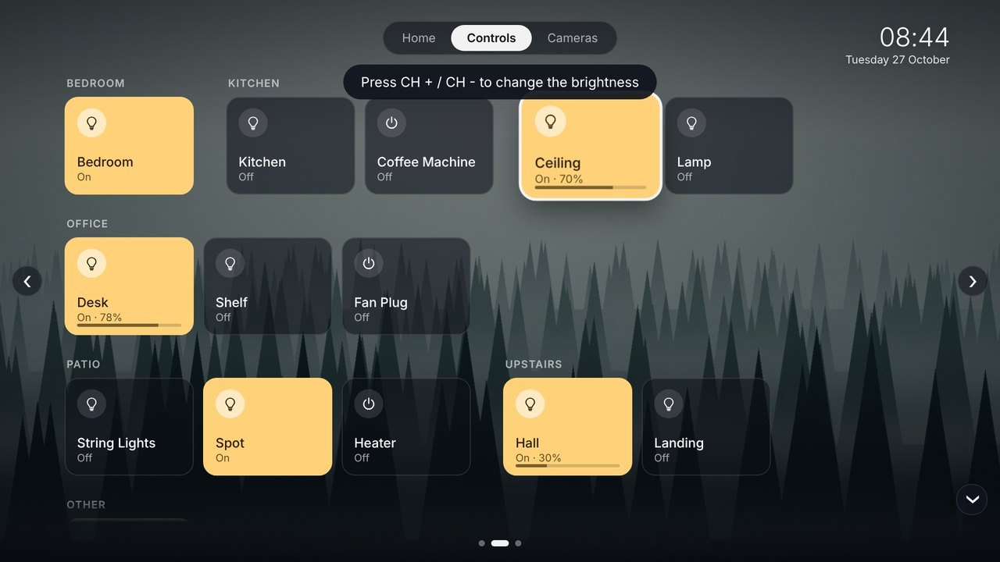
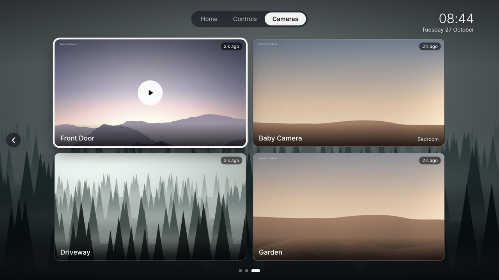
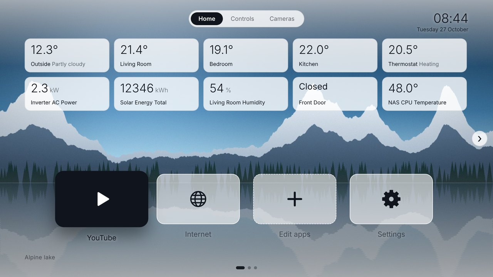
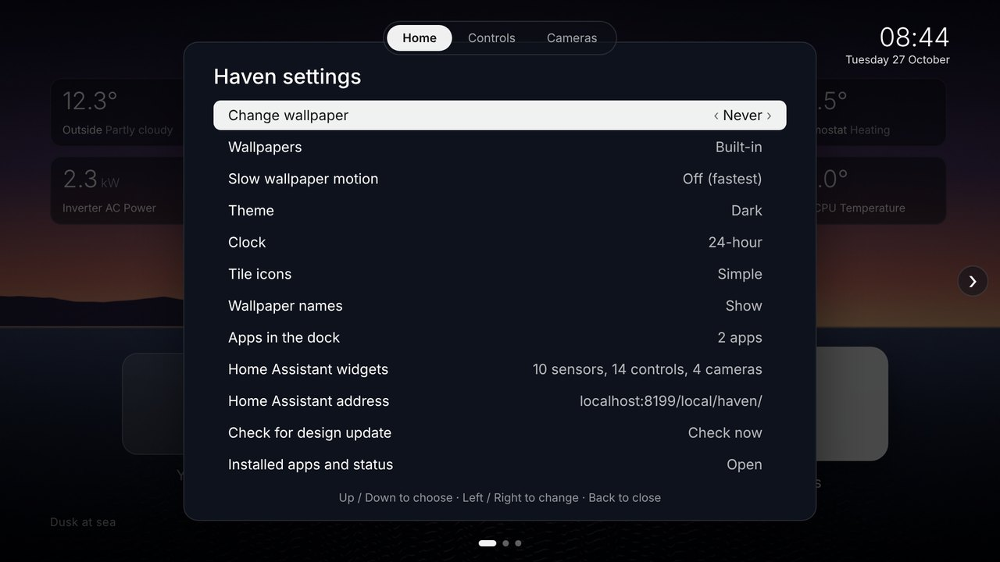
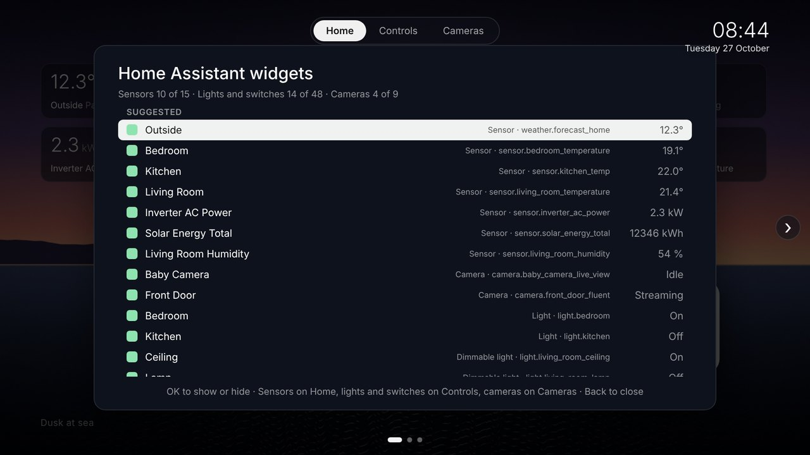
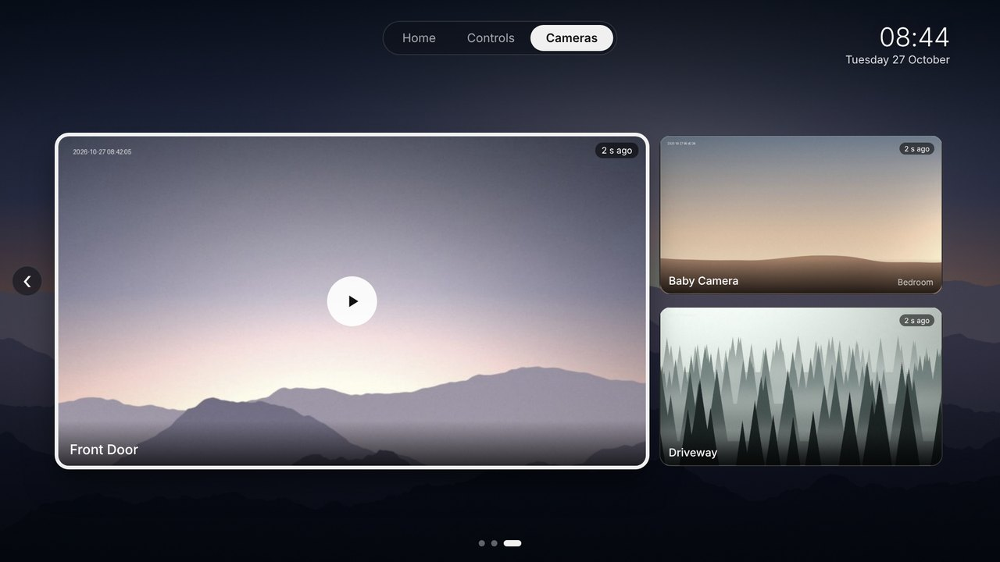

# Haven

A Home Assistant powered home screen for Samsung Tizen TVs. Three pages you slide between
with the remote: **Home** (your apps and up to 15 sensors), **Controls** (lights and switches
by room, with dimming) and **Cameras** (up to 9 live cameras in an adaptive grid). The design
lives on Home Assistant, so you change it there and the TV updates itself.



| Controls | Cameras |
|---|---|
|  |  |

| Light theme | Settings |
|---|---|
|  |  |

| Widget picker | Cameras, three in one layout |
|---|---|
|  |  |

*Screenshots use sample data.*

## Why

Samsung's home screen on older Tizen TVs is slow and full of ads. Android TV owners can
debloat over ADB and replace the launcher, but Tizen allows neither. Haven is a normal
sideloaded Tizen web app instead: no root, no exploits, fully reversible. Home Assistant
opens it whenever the TV turns on, so in practice it becomes the home screen.

## Features

- **Three pages:** Home, Controls and Cameras. Tabs at the top, dots at the bottom and a
  round arrow at each side show where you are. Press Right on the last item (or Left on the
  first) to reach the arrow, then Right / Left again or OK to slide to the next page.
- **Home:** clock, wallpaper, up to 15 live sensor cards (5 by 3: weather, room
  temperatures, solar production, humidity, doors, thermostats) and the app dock. No
  buttons and no scrolling, so it stays calm.
- **Controls:** a tile for each light and switch, grouped by room (rooms A to Z, anything
  without a room last under *Other*), in the order you picked them within each room. OK
  switches it on or off, CH + / CH - dims it right on the tile. Up to 48; the page scrolls
  up and down if they don't all fit.
- **Cameras:** up to 9, laid out to fill the screen: 1 camera full size, 2 side by side, 3
  as one large and two small, then 2 by 2, 3 by 2 and 3 by 3. Stills refresh on their own,
  OK opens the live stream through Home Assistant's HLS.
- **Clock and wallpapers:** six built-in nature scenes plus your own photos from Home
  Assistant, resized for the TV automatically.
- **Auto-discovery:** on first connection Haven picks sensible defaults (weather, a few
  temperatures, solar, humidity, up to 12 lights and all cameras). It finds solar from the
  Energy dashboard, prefers camera sub-streams, and skips diagnostic entities. A picker on
  the TV lets you change everything, grouped by area.
- **Dark, light or auto theme:** auto follows `sun.sun`.
- **App dock:** YouTube and the Internet browser by default. Add any installed app from a
  checklist on the TV and put them in your own order; the dock scrolls when it's wider
  than the screen. You can also drop all apps from the dock.
- **Remote design updates with a safety net:** offline cache, automatic rollback of
  broken updates, and a safe mode.

## How it works

```
 Samsung TV (Tizen)                       Home Assistant
 ┌──────────────────────────┐             ┌─────────────────────────────────────┐
 │ Haven shell (installed)  │  HTTP       │ /config/www/haven/                  │
 │  - remote keys, app      │ ──────────► │   design/style.css, design.js       │
 │    launching, AVPlay     │             │   wallpapers/*.jpg + list.json      │
 │  - loads + caches design │             │                                     │
 │  - rollback, safe mode   │  WebSocket  │ API: states, areas, energy prefs,   │
 │ Haven design (from HA)   │ ◄─────────► │   subscribe_entities, call_service, │
 │  - widgets, cameras,     │             │   camera/stream (HLS)               │
 │    picker, theme         │             │                                     │
 └──────────────────────────┘             │ package: wallpaper sync script      │
                                          │ automation: open Haven on power-on  │
                                          └─────────────────────────────────────┘
```

- **The shell** (`app/`) is installed on the TV once. It handles the remote, launches apps,
  and loads the design.
- **The design** (`style.css` + `design.js`) lives in `/config/www/haven/design/`. Haven
  checks for changes at launch, when you return to it, and every 15 minutes. The last
  working version is cached on the TV.
- **Widgets** use one WebSocket to Home Assistant, subscribed only to the entities on
  screen, so the TV's CPU stays mostly idle.
- **Wallpapers** come from a small Python script on Home Assistant (Pillow ships with HA).
  It writes 1920x1080 copies of your picture folder plus a `list.json` for the TV.
- **Cameras:** the Cameras page shows recent stills from Home Assistant's camera proxy
  (only while that page is on screen). OK asks Home Assistant to convert the camera's RTSP
  feed to HLS; Haven plays it with the TV's video element, then falls back to Samsung's
  AVPlay, then to refreshing snapshots. One live stream at a time.

## Requirements

- **TV:** a Samsung Tizen TV that allows Developer Mode. Built and tested on a UE49NU7100
  (2018, Tizen 4.0). Other 2017 to 2021 models should behave similarly; newer ones are
  untested.
- **Home Assistant** with file access to `/config`, through the Samba share or Studio Code
  Server add-on. Written against HA 2026.x.
- **A computer on the same network**, with Tizen Studio 6.1 (instructions below are for
  Windows) and a Samsung account for the signing certificate.
- **Optional:** the Samsung Smart TV integration in Home Assistant, to open Haven
  automatically at power-on.

## Repository layout

```
app/                            the Tizen app (installed on the TV)
  config.xml                    app ID HavenHome1.Haven, privileges, network access
  index.html                    shell page
  shell-config.example.js       copy to shell-config.js and add your HA address + token
  shell/boot.js                 loader, cache, rollback, safe mode, app launching
  design/                       built-in copy of the design (first run and fallback)
  img/                          built-in wallpapers + walls.js
ha/                             files for Home Assistant's /config
  www/haven/design/             the live design the TV loads
  www/haven/wallpapers/         filled by the sync script
  haven/haven_wallpapers.py     resizes your pictures and writes list.json
  packages/haven.yaml           shell_command, sync automation, sync script
  examples/haven_open_on_power_on.yaml
tools/
  serve.py                      fake Home Assistant for testing in a desktop browser
  publish_design.py             copies app/design to Home Assistant
  make_wallpapers.py            regenerates the built-in wallpapers and icon
docs/screenshots/
```

## Setup

### 1. Home Assistant

1. Copy the files from `ha/` into `/config`:
   - `ha/www/haven/` to `/config/www/haven/`
   - `ha/haven/haven_wallpapers.py` to `/config/haven/haven_wallpapers.py`
   - `ha/packages/haven.yaml` to `/config/packages/haven.yaml`
2. In `haven.yaml`, change `/media/Pictures` to your picture folder. It is only read; the TV
   gets resized copies without location data.
3. Make sure `configuration.yaml` loads packages. `packages:` must sit **under**
   `homeassistant:`; on its own at the top level you get *Integration 'packages' not
   found*.
   ```yaml
   homeassistant:
     packages: !include_dir_named packages
   ```
4. Check the configuration, then restart Home Assistant. Since HA 2026.2, Developer Tools
   is under **Settings** (bottom of the page), not in the sidebar. The restart is also
   needed the first time `/config/www` exists.
5. Run the wallpaper sync once: **Settings > Developer Tools > Actions**,
   `shell_command.haven_wallpapers`, **Perform action**. The response shows something like
   `haven_wallpapers: 42 wallpapers, 42 new`. After that it runs at startup and every 15
   minutes. Each run stops after 50 seconds, so a big first import takes a few runs.
6. Check in a browser: `http://<HA-IP>:8123/local/haven/wallpapers/list.json` should list
   your pictures.
7. Create a long-lived access token: your HA profile > **Security** > **Long-lived access
   tokens** > **Create token**. Copy it, because it's shown only once.

### 2. Build and install on the TV

**Configure the app**

1. Copy `app/shell-config.example.js` to `app/shell-config.js` and fill in:
   - `base`: `http://<HA-IP>:8123/local/haven/`. Give HA a fixed IP (DHCP reservation);
     the TV may not resolve `homeassistant.local`.
   - `haToken`: the token from step 1.7.

**Prepare the TV**

2. **Developer Mode:** on the TV, open **Apps**, then type **1 2 3 4 5**. On the Samsung
   Smart Remote, press the **123** button for an on-screen number pad. Switch Developer
   Mode **On**, enter your computer's IP, then fully restart the TV: hold the power button
   until it reboots, or unplug it for 30 seconds.

**Prepare the computer**

3. **Tizen Studio:** download the **web-ide** installer for your OS from the
   [Tizen Studio download page](https://developer.tizen.org/development/tizen-studio/download).
   On Windows, install it to a path without spaces, such as `C:\tizen-studio`.
4. **Package Manager:** open `C:\tizen-studio\package-manager\package-manager.exe` and
   install:
   - **Extension SDK** tab: **TV Extensions Tools** and **Samsung Certificate Extension**.
   - **Main SDK** tab, under Tizen SDK tools: **Certificate Manager**. The web-ide install
     may leave it out, which shows up as *Certificate Manager is not installed or the
     installation path is invalid*.

**Connect, certify, install**

5. **Connect to the TV** from PowerShell. Adding the tools to the path also avoids
   PowerShell's *"sdb is not recognized"*.
   ```powershell
   $env:Path += ";C:\tizen-studio\tools;C:\tizen-studio\tools\ide\bin"
   sdb connect <TV-IP>
   sdb devices          # should list your TV model
   ```
6. **Samsung certificate:** in Tizen Studio, go to **Tools > Certificate Manager**. Click
   **+**, choose **Samsung** (not Tizen), then **TV**, and name the profile `haven`.
   - Create an author certificate (pick a password) and sign in with your Samsung account.
   - For the distributor certificate, choose privilege **Public**. The TV's ID is added
     automatically while it's connected.
7. **Permit to install:** in **Tools > Device Manager**, right-click your TV and choose
   **Permit to install applications**. Without this, the install fails with error
   **118012**.
8. **Package, install and run:**
   ```powershell
   cd <path-to>\haven-tv
   tizen package -t wgt -s haven -- app
   tizen install -n Haven.wgt -s <TV-IP>:26101 -- app
   tizen run -p HavenHome1.Haven -s <TV-IP>:26101
   ```
   Delete `app\Haven.wgt` before packaging again, so it doesn't end up inside the new one.
9. **First-run check:** press **Yellow** on the remote. The status panel should show:
   - *Design: Home Assistant*
   - *Home Assistant widgets: connected*
   - a wallpaper count
   - YouTube and Internet highlighted green in the app list

Back up `app/shell-config.js` and your certificate folder
(`C:\Users\<you>\SamsungCertificate\haven`). Updating Haven in place later requires the
same certificate; with a new one you'd have to uninstall it first and lose its settings.

### 3. Open Haven when the TV turns on

Tizen won't let a sideloaded app replace Smart Hub, but Home Assistant's Samsung Smart TV
integration can launch it.

1. Test it first in **Developer Tools > Actions**:
   ```yaml
   action: media_player.play_media
   target:
     entity_id: media_player.samsung_tv
   data:
     media:
       media_content_type: app
       media_content_id: HavenHome1.Haven
   ```
2. If Haven opens, add the automation from
   [`ha/examples/haven_open_on_power_on.yaml`](ha/examples/haven_open_on_power_on.yaml).
   It triggers on the **media_player** entity (not the remote one) turning on, waits 10
   seconds, and opens Haven.
3. Check under **History** that HA really sees your TV go off and on. Some TVs stay "on"
   in standby.
4. If the TV asks to allow Home Assistant after every power cycle, go to TV **Settings >
   General > External Device Manager > Device Connection Manager**. Set **Access
   Notification** to **First Time Only**, and set Home Assistant to **Allow** in the
   **Device List**.
5. Turn **Autorun Last App** off (Settings > General > Smart Features). With both on, the
   TV reopens Haven itself, the automation's launch arrives while it's already open, and
   the TV shows *Not available*.

Developer Mode can stay on or be turned off; Haven keeps running either way. You only need
it again to reinstall the app.

## Using it

| Key | Does |
|---|---|
| Arrows | Move between items on the page (the dock on Home, tiles on Controls and Cameras) |
| Right on the last item / Left on the first | Focus the round arrow at the side of the screen |
| Right / Left again, or OK, on the arrow | Slide to the next page (the opposite arrow key goes back to where you were) |
| OK | Open an app, Edit apps or Settings on Home; switch a light or switch on Controls; open a camera on Cameras |
| CH + / CH - on a dimmable light (Controls) | Brightness up / down in 10 % steps, shown on the tile (down to 1 %, then off) |
| Left / Right in a camera | Switch to the previous / next camera |
| Back | Close a panel or camera; on Controls or Cameras, go back to Home |
| Yellow | Installed apps and status (design source, HA connection, camera player) |
| Red, within 6 s of opening | Safe mode: the built-in design |

On a remote without CH keys, Page Up / Page Down do the same (handy in a browser preview).

**Choosing apps:** the **Edit apps** tile (+) in the dock, or Settings > **Apps in the
dock**:
- *In the dock* lists your apps in dock order; *Other apps* lists everything else installed
  on the TV, by name. Haven itself and hidden system apps aren't offered.
- **OK** adds or removes an app. The focus stays where you are, so you can tick several in
  a row.
- To have no apps at all, untick them all; the dock keeps only Edit apps and Settings.
- To reorder, press **Right** on an app in the dock to pick it up, **Up / Down** to move
  it, and **OK** to drop it.
- Apps show their own icon; apps without one show their initials. YouTube and Internet
  keep their simple symbols unless Settings > Tile icons is set to App icons.

**Controls page:**
- Tiles are grouped by room: rooms A to Z, anything without a room last under *Other*.
  Within a room they keep the order you ticked them in the picker.
- A lit tile turns bright; dimmable lights show the level ("On · 60%") and a thin bar.
- **CH + / CH -** change the focused light's brightness on the tile itself, no pop-up.
  Holding a key sends one update to Home Assistant when you let go, not one per step. The
  first time you focus a dimmable light, Haven shows a short tip.
- Lights that only switch on and off say so if you try to dim them.
- More than fit on the screen? The page scrolls up and down as you move, with soft edges
  and small arrows showing there's more.

**Choosing widgets:** Settings (gear tile) > **Home Assistant widgets**. It lists a
*Suggested* section, then everything else grouped by area, with live values. OK ticks or
unticks; items appear in the order you tick them. Each kind goes to its own page: sensors
to Home (up to 15), lights and switches to Controls (up to 48), cameras to Cameras (up to
9). Names are shortened by room, so "Living Room Temperature" shows as "Living Room".
Rename the entity in HA for a different label.

**Cameras:**
- The grid adapts to how many you pick: 1 fills the screen, 2 sit side by side, 3 show as
  one large and two small, then 2 by 2, 3 by 2 and 3 by 3. No scrolling.
- Stills refresh every 4 seconds with up to 4 cameras. With more, the focused one refreshes
  every 3 seconds and the others every 12, to keep Home Assistant and the TV relaxed. A
  small badge shows how old each picture is. Nothing is fetched while you're on another
  page.
- OK opens the live stream; Left / Right in the player switch cameras, Back returns to the
  grid.
- Prefer the light sub-stream entity (Reolink *Fluent*, Tapo *SD* or *live view*): it
  starts quicker, and every older Samsung decodes it. Use an H.264 stream rather than
  H.265.
- Expect the picture a few seconds behind live, and 2 to 5 seconds to start.
- Home Assistant's HLS only passes AAC audio, so some cameras (the Tapo C200, for one) have
  no sound this way.
- The Yellow panel shows which player worked on your TV and the last problem, if any.

**Other settings:** wallpaper interval, wallpaper source (built-in, Home Assistant or both),
slow motion (off by default, it costs GPU), theme, 12 or 24-hour clock, app icons,
and the Home Assistant address.

## Changing the design

Edit `/config/www/haven/design/style.css` or `design.js` on Home Assistant:

- **At home:** open the Samba share in your editor, or copy this repo's design over with
  `python tools/publish_design.py \\homeassistant\config\www\haven`.
- **Anywhere:** use the Studio Code Server add-on inside the HA web UI.

How the TV handles it:

| Situation | What the TV shows |
|---|---|
| You saved a change | Haven downloads it and reloads after 20 s without remote presses, or when you return to it |
| The change has an error | The previous working design, plus a message with the error. That version is skipped until you edit again. |
| Home Assistant is offline | The last working design, instantly. Built-in wallpapers instead of your photos. |
| First launch with HA offline | The built-in design |
| It looks wrong | Press Red within 6 seconds of opening Haven |

Rules for `design.js`:
- Plain ES5, since the 2018 web engine is an old Chromium: no arrow functions,
  `let`/`const`, classes or `?.`.
- Use `window.Haven` for anything TV-specific.
- Call `Haven.ready()` once the screen is drawn. If it doesn't, the shell rolls the change
  back.

Needs a reinstall: anything in `config.xml`, `shell-config.js` (address default, token),
`index.html` and `shell/boot.js`. Copy your favourite design back into `app/design/` before
reinstalling, so it becomes the new fallback.

## Troubleshooting

| Symptom | Fix |
|---|---|
| *Integration 'packages' not found* | `packages:` must be under `homeassistant:` in `configuration.yaml` |
| No Developer Tools in the sidebar | HA 2026.2+: Settings, bottom of the page, or Ctrl+K |
| Developer Mode menu doesn't exist | It's hidden: Apps screen, then type 1 2 3 4 5 |
| *sdb is not recognized* in PowerShell | Use `.\sdb`, or add `C:\tizen-studio\tools` to `$env:Path` |
| *Certificate Manager is not installed or the installation path is invalid* | Package Manager > Main SDK > Tizen SDK tools > Certificate Manager > install |
| Only "Tizen" in the certificate wizard, no "Samsung" | Install Samsung Certificate Extension, restart Tizen Studio |
| Install fails with *install failed[118012]* | Device Manager > right-click TV > Permit to install applications |
| TV boots to Samsung's home, not Haven | Expected; use the power-on automation (setup step 3) |
| TV asks to allow Home Assistant every time | Device Connection Manager > Access Notification > First Time Only |
| *Not available* when the automation runs | Turn off Autorun Last App |
| Automation never fires | Trigger on the media_player entity; check History shows off then on |
| "Home Assistant token rejected" at the top | Wrong `haToken` in `shell-config.js`; fix and reinstall |
| A camera shows only snapshots | Yellow panel shows why; use the camera's H.264 sub-stream |

## Security notes

- The token in `shell-config.js` can do anything its HA user can do, and it is packaged
  into the app on the TV. Keep the file out of git (it's in `.gitignore`) and never copy it
  into `/config/www`.
- Consider a separate non-admin HA user for the TV. It can still read and switch
  everything, but it can't change HA's configuration.
- If the TV is lost or sold, delete the token in HA.
- Everything in `/config/www` can be fetched without logging in by anyone who can reach
  your HA, including from the internet if HA is exposed. Only the resized wallpapers and
  the design are there, never the token.

## Try it on a computer

```
python tools/serve.py        # fake Home Assistant at http://localhost:8123/local/haven/
```

Copy `app/shell-config.example.js` to `app/shell-config.js`, then open
`app/index.html?base=http://localhost:8123/local/haven/` in Chrome. Keyboard controls:
- **Arrow keys** move, **Enter** opens, **Esc** closes.
- **Page Up / Page Down** stand in for CH + / CH - (dimming on Controls).
- **`Y`** toggles the status panel, **`r`** within 6 seconds is safe mode.

Edit `ha/www/haven/design/*` and watch it update. Add `&ha=http://<HA-IP>:8123&token=<token>`
to try the widgets against a real Home Assistant. That may need `cors_allowed_origins`
under `http:` in HA; the TV app itself isn't limited by this.

## Undo

Uninstall Haven from Apps on the TV and turn Developer Mode off. On Home Assistant, delete
`/config/www/haven`, `/config/haven`, `/config/packages/haven.yaml` and the power-on
automation, then revoke the token.

## Credits

Built by [natureglass](https://github.com/natureglass) together with Claude (Anthropic).
